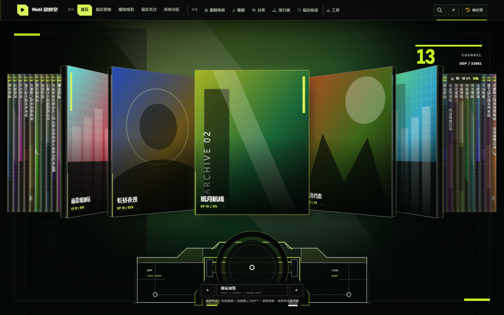
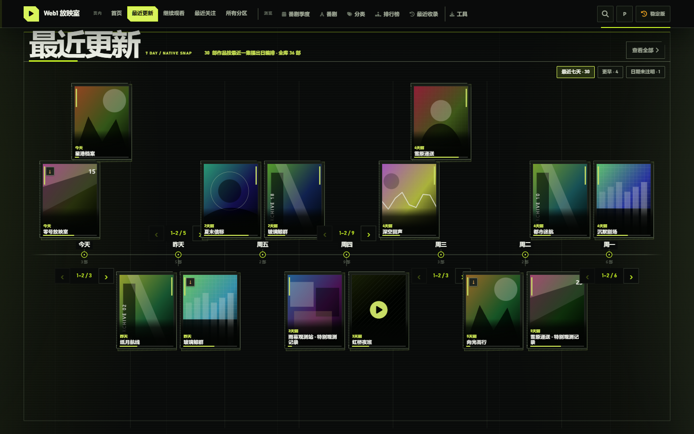
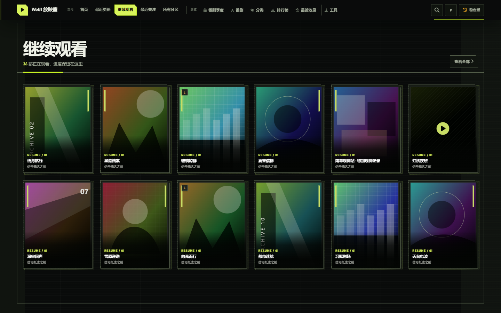
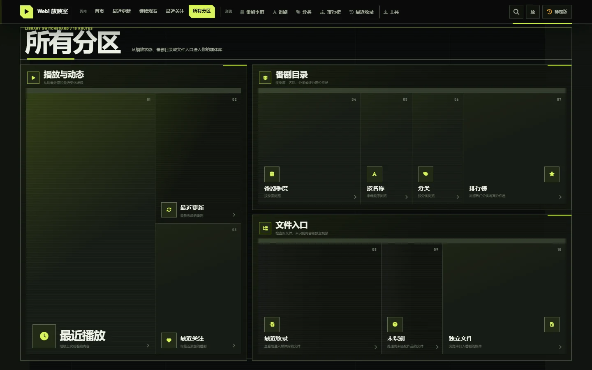
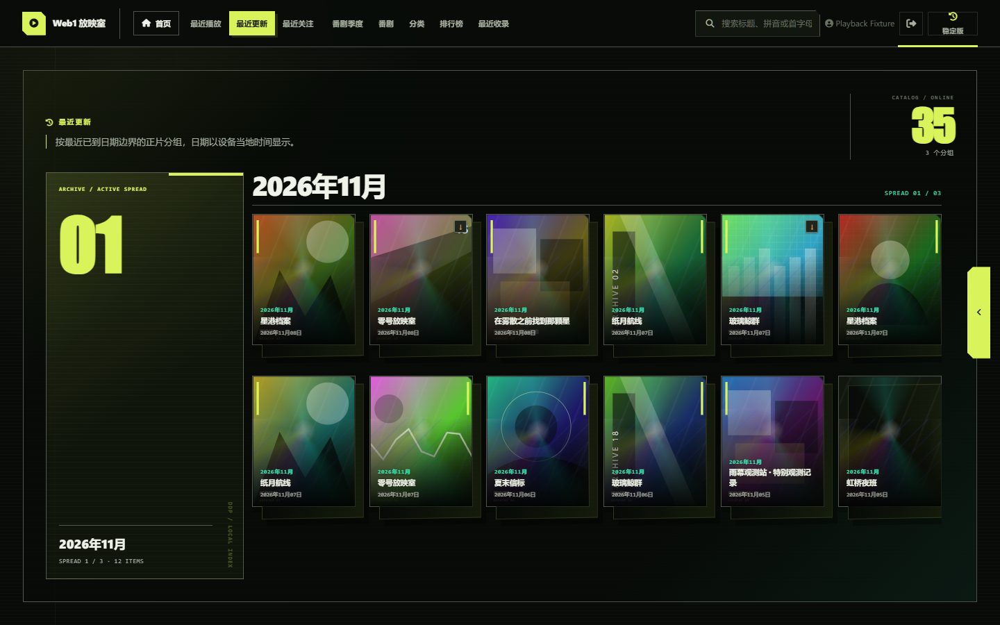
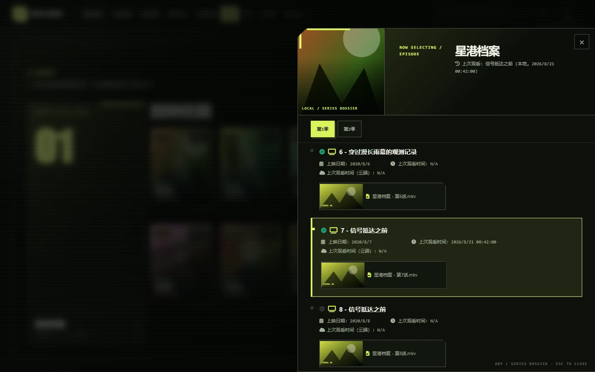
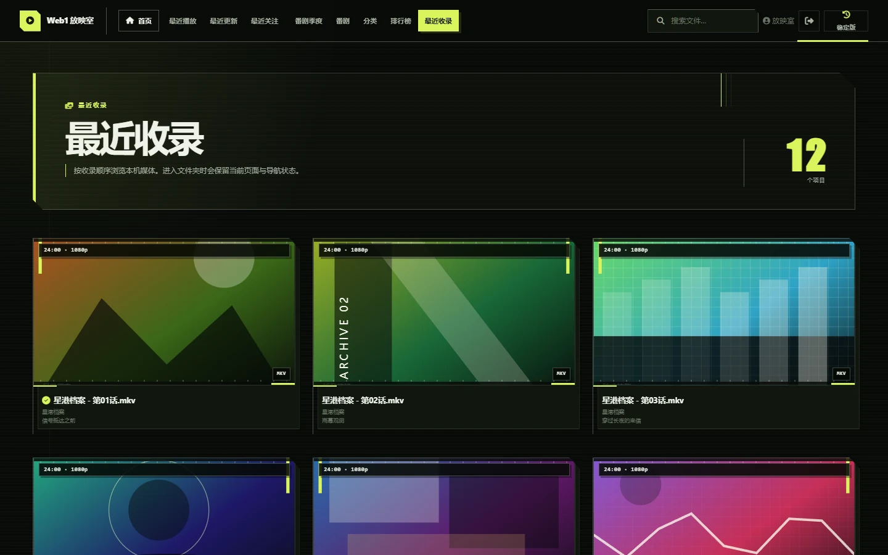
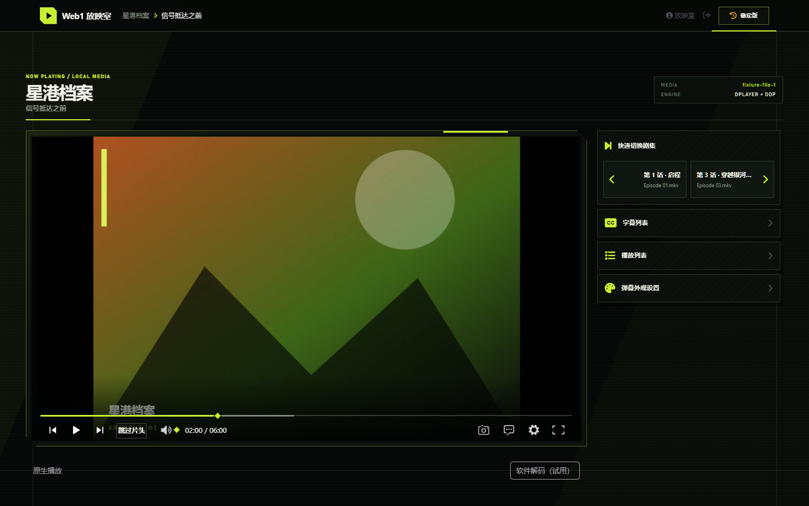
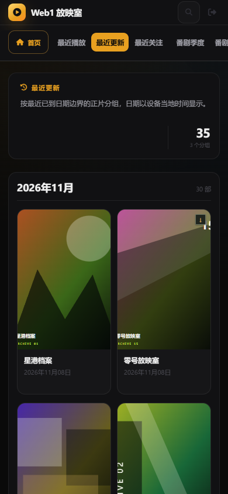
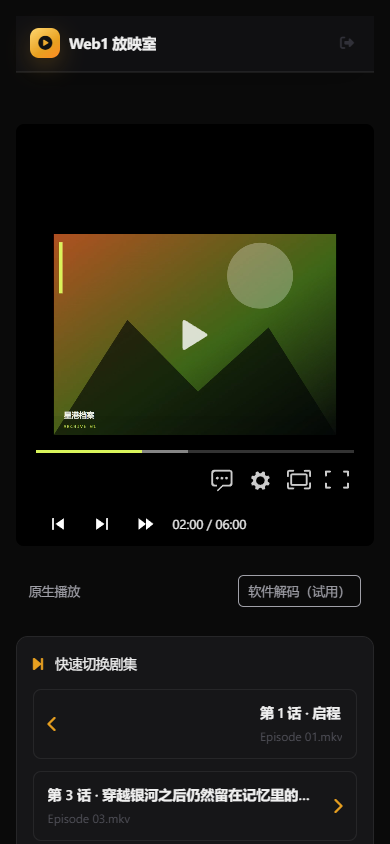

# DanDanPlay Personal Web Style

弹弹play Web1 的非官方视觉与交互改版，用连续 CD 架、媒体封套和放映控制台浏览自己的媒体库。

**当前版本：3.6 · 兼容弹弹play Windows 18.2.4**

**[下载 3.6 安装包 ZIP](https://github.com/OuNiSang/DanDanPlay-Personal-Web-Style/releases/download/3.6/DanDanPlay-Personal-Web-Style-3.6.zip)** · [版本说明与校验文件](https://github.com/OuNiSang/DanDanPlay-Personal-Web-Style/releases/tag/3.6)

3.6 加入 **F 全屏切换、手机横拖预览与松手定位**，并更新首页首次选片、放送日期与跨日归档、媒体库连续浏览。兼容弹弹play Windows 18.2.4。3.5 的单一状态角标、播放恢复及客户端 E-AC-3 软件解码继续保留。

> 电脑端默认使用 3.x 界面，右上角可切换稳定版。宽度不超过 768px 时自动使用 2.4 稳定布局。桌面模式仍沿用 Web1 3.0 标识，以保留原有偏好设置。新的播放器控制同时适用于桌面、稳定版和手机。

## 界面预览

### 连续 CD 架与首次展开

最近播放作品排成一整架收藏。架子高速入场、减速停稳，再原位展开；中间卡面便于阅读，两侧书脊保持连续。首次选片核对完成后，展开只等待实际使用封面的加载与解码；其余详情补全和外部搜图不挡住这次展开。后到数据保留当前选中作品。

首次刷新会用本地文件观看记录核对默认作品，再与候选观看详情比较；封面已经呈现后，晚到数据保留本次作品和图片。文件索引读取失败时明确提示并保留其他浏览入口；索引有效但没有本地候选时使用限量详情回退。候选详情失败仍保留已确认的本地作品身份，不自动刷新整页。




### 开盒、装载与播放

选择作品后打开盒体，点击碟片装入播放器并进入播放页。Hero 的过场从碟片开始；详情文件行、上下集和播放列表则从实际点击的矩形区域展开。慢请求期间保持加载，媒体元数据就绪后揭幕，支持取消及错误退出。


### 最近更新与继续观看

最近更新左侧固定为**今天**，向右依次是昨天及前五天，按访问者设备的本地日历划分。未来放送日期不提前计入更新，未知日期保持明确状态；拥挤日期在原有栏位内翻页，手机保留完整近期列表，“更早”和其他作品可进入媒体库归档。

每张封面仅保留一个小角标：数字是可信的最新话数，**✓** 表示本地已有对应话，**↓** 表示本地尚缺。独立底色在复杂封面上保持可读；观看进度留在原有进度条与辅助信息中。无法确认最新话数时不伪造同步，也不显示“待核对”。日期继续兼容跨午夜、显式时区偏移和夏令时。







### 媒体库与详情

番剧库保留分页封套、搜索、键盘操作及连续侧边详情。打开、加载和关闭详情时，背景卡片、归档分页和滚动位置保持不动；最近观看信息到达后更新现有卡片。季度栏和剧集列表共用抽屉宽度，定位最近观看集数时只滚动剧集列表。

后台详情或日期变化保留日内分页、可见卡片和键盘焦点；新到放送日的作品会补入列表。当前聚焦项因日期过滤而移除时，焦点会转交给可见邻项或空态、搜索入口，不丢到整个页面。





文件列表保留本地、远程、最近收录、未识别及独立文件入口。



### 播放器

播放控制栏内可直接切换**上一集 / 下一集**，顺序与播放列表一致，首尾自动禁用。**跳过片头**仍向前跳过 85 秒，保持原先播放或暂停状态，并限制在片尾。

按 **F** 进入或退出播放器全屏；输入框、弹幕输入、输入法、组合键和长按重复不会误触。手机在视频表面左右拖动时显示目标位置，松手只提交一次；横跨整个播放器约对应 **90 秒**，保持原有播放或暂停状态。纵向滚动、多指、取消和换集不会提交旧位置，进度条、音量和设置保留各自操作。

鼠标或触屏点击后释放按钮焦点，播放中的控制栏按原有计时自动收起；键盘操作保留清晰焦点，不误触全局播放快捷键。窄播放器使用图标与双行控制栏，为时间、弹幕和全屏按钮留出空间，三个控制区域均为 44×44px。




### 手机端

| 首页 | 番剧库 |
| --- | --- |
|  |  |



标有 3.6 的预览来自本次最终候选；历史标有 3.4/3.5 的素材展示保留的既有界面。所有公开预览使用虚构作品、明暗封面、长短标题与缺图案例，不含真实媒体清单、账号、服务器或播放记录。GIF 是界面演示，不代表实际设备帧率。

## 安装与回退

1. 下载独立附件 **`DanDanPlay-Personal-Web-Style-3.6.zip`** 并完整解压，不要直接在压缩包内运行。
2. 建议先退出弹弹play。
3. 双击 `manage-style.bat`，选择 `1` 安装或重新应用。
4. 在弹弹play中开启远程访问，进入客户端显示地址的 `/web1/index.html`。
5. 需要回退时再次运行管理器并选择 `2`；选择 `3` 查看安装与版本状态。

安装包包含 manifest 中列出的运行文件、第三方许可与管理器、安装说明；截图/GIF 留在项目主页。使用同一 Release 的 `.zip.sha256` 文件核对完整性。

管理器默认中文，主菜单选择 `4` 可切换英文。优先读取 Web1 目录同级的 `dandanplay.exe` 版本；版本不匹配或无法识别时会提示确认。兼容目标为 `18.2.4`，发布安装检查使用 `18.2.4.0`，不跳过版本检查。

待覆盖文件有变化时先备份；重复应用同一版本不重复创建备份。回退恢复原有文件，并移除安装时新增的文件。备份位于：

```text
%LOCALAPPDATA%\DanDanPlay-Personal-Web-Style\backups
```

弹弹play更新覆盖网页后可重新安装。跨版本更新可能调整模板或 API，请检查兼容目标并保留备份。

GitHub 自动生成的 `Source code` 压缩包仍可用，推荐使用独立安装附件。附件下载次数表示请求次数，不等于独立用户或安装人数；本项目没有为此添加使用遥测。

## 更新记录

### 3.6

- 新增 F 全屏切换及手机横向进度预览；正常松手只定位一次，保留输入、取消、滚动和播放状态。
- 首次刷新用最新本地观看候选核对默认作品，晚到元数据保留已经呈现的作品和图片。
- 更新放送日期与设备本地跨日归档、未来/未知日期处理，以及媒体库连续浏览和搜索。
- 修正晚到详情重置日内分页、跨日新增作品漏显，以及后台更新导致滚动位置或键盘焦点丢失。
- 修正卡片揭示期间的指针与文字显示归属；保留单一状态角标、上下集和 85 秒片头操作。
- 兼容目标更新为弹弹play Windows 18.2.4，安装管理器按 18.2.4.0 检查；运行清单仍为 77 项，12 个运行文件有功能增量。
- 私人媒体映射和依赖本机预生成媒体的音轨服务不属于静态安装包；原生播放与既有软件解码继续工作。

### 3.5

- 每张相关封面仅一个小号最新话数与本地状态角标；不再出现“待核对”，未知数据不冒充已同步。
- 修正季号提取及分组，第一季文件不再误归特别篇；不改媒体库匹配或原文件。
- 修正首帧等待、暂停恢复、明确重试后的定位与转场遮罩；恢复零音量控件的可用操作。
- 增加固定官方 libmedia AVPlayer 1.3.1 客户端直接解码，仅在同源 MP4 确认 E-AC-3 且浏览器原生不支持时自动启用。软解码已获用户验收通过。
- 保留原生播放切换与安装备份回退；更新隐私安全单角标预览、独立 ZIP 与 SHA-256 附件。

### 3.4

- 在播放器内加入上一集、下一集图标，沿用播放列表顺序及首尾禁用状态。
- 修复“跳过片头”的指针焦点残留，恢复桌面和触屏点击后的自动隐藏，保留键盘可见焦点。
- 为手机和窄播放器提供图标、44px 操作区域及双行布局，检查 320–390px 与长时长显示。
- 最近更新按本地日历从今天向前排列七天，未来内容单独展示，修复拥挤日期卡片丢失。
- 打开、加载和关闭番剧详情时保留背景位置；最近观看信息更新现有卡片，剧集定位不再滚动背景。
- 更新候选包截图与效果 GIF，提供独立安装 ZIP 和 SHA-256 校验文件。

### 3.3

修正本地文件覆盖进度、设备时区、首次展开图片就绪与慢播放加载；增加 85 秒片头跳过及独立 ZIP，修复缺图和导航遮挡。

### 3.2 / 3.1

统一播放入口的放映闸门，完善连续全宽 CD 架、循环切换、碟片深度和详情抽屉。

### 3.0 / 2.4

完成电脑端首页、媒体库、文件列表和播放器统一改版；手机与窄屏沿用 2.4 稳定布局。

## 验证范围

既有页面检查覆盖 2048、1440、1280、900、768 和 390px；播放器额外检查 360/320px、长时长、鼠标、键盘、触屏、全屏及二十次连续换集。功能记录覆盖正常、空内容、加载、失败、日期边界、重复打开/关闭详情、跳过片头和安装回退。

保留 NancyFx 模板、现有媒体库 API、DPlayer 控件、弹幕、播放记录、文件路由和版本偏好。新增固定版本 libmedia 客户端解码依赖；原生播放仍保留。安装器验证覆盖 PowerShell 7 和 Windows PowerShell 5.1。

无头浏览器不等于实体手机、Safari 原生视频全屏或实际显卡认证。原生修饰键的新标签创建已检查，新标签完整加载仍有测试环境限制。快速连续切换的 60Hz 帧预算与真实显卡表现尚未完成验收，**不承诺 60fps**。不同编码、字幕与转码服务仍取决于弹弹play和浏览器。

### 软件解码与验证边界

软件解码使用官方 `@libmedia/avplayer@1.3.1`，固定源码提交 `152f629d3021fd8013efa464fcb7b55f9fbe7753`。E-AC-3 直接解为 PCM；不会上传、改写原媒体或生成转码副本。版本与第三方说明见 [libmedia NOTICE](payload/js/vendor/libmedia-1.3.1/NOTICE.txt)。

播放器下方可切回原生；视频 URL 添加 `decoder=native` 强制原生，`decoder=software` 可显式试用软解码。自动判断失败、信息不足或混合音轨时保留原生路径。

**当前软解码不显示高级 ASS 字幕**，会明确提示；切回原生后恢复原生字幕路径。软解码下原生画中画、AirPlay 和截图功能不可用。已验收不代表全部编码、容器、手机或长时间播放均已验证；HEVC 软件视频解码可能消耗较多 CPU 与内存。未声称机器量化同步误差达到固定毫秒界限。

全源码校验仍有 **5 项既存下载/遥控页面检查失败**：下载页同一整页重试命中两条规则，另有下载、电脑遥控、Android 遥控的 `beforeunload` 清理各一条。这些文件不在本次发布 payload，规则未删除、失败未改称通过，也未将无关修复混入本批。

## 自定义目录与打包

```powershell
pwsh -NoProfile -File .\scripts\manage-style.ps1 -Action install -TargetPath "D:\path\to\web"
pwsh -NoProfile -File .\scripts\manage-style.ps1 -Action status -TargetPath "D:\path\to\web"
pwsh -NoProfile -File .\scripts\manage-style.ps1 -Action restore -TargetPath "D:\path\to\web"
```

管理器兼容 Windows PowerShell 5.1。命令行遇到版本不匹配时默认退出；仅在自行确认兼容性后才考虑 `-Force`。

维护者可用 PowerShell 7 执行 `scripts/build-release.ps1 -Version 3.6`，向 `dist/` 生成 ZIP 与校验文件。脚本核对 manifest 和 payload 完整文件集合，并拒绝覆盖已有产物。

`payload/` 按实际测试源码保留文件字节，Git 不自动改写其中的行尾；安装附件与对应版本的 payload 可逐文件校验。

## 声明

本项目是个人维护的非官方界面修改，与弹弹play官方无隶属或背书关系。应用中的作品图片来自用户媒体库及元数据服务；公开包不附带真实番剧图片、媒体、账号配置、服务器地址、播放记录；弹弹play自带的基础前端资源仍由原应用提供。libmedia 第三方组件及许可随本版本一并提供。

本版第三方解码器字节未变，对应源码、构建说明和许可文档继续由 [3.5 源码材料 ZIP](https://github.com/OuNiSang/DanDanPlay-Personal-Web-Style/releases/download/3.5/DanDanPlay-Personal-Web-Style-3.5-corresponding-source.zip) 单独提供。FFmpeg 来源按上游同版生成头文件关联到固定提交；未执行逐字节重编验证，WASM 不作 LGPL-only 声明。
