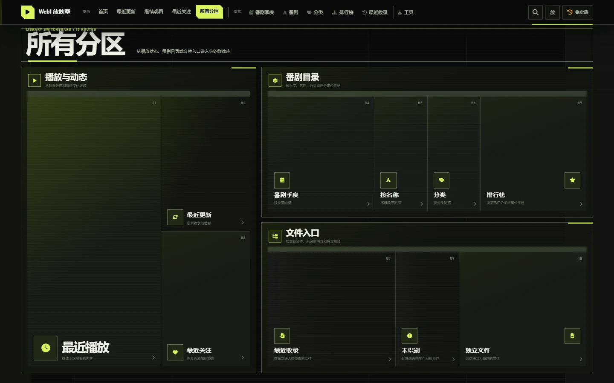
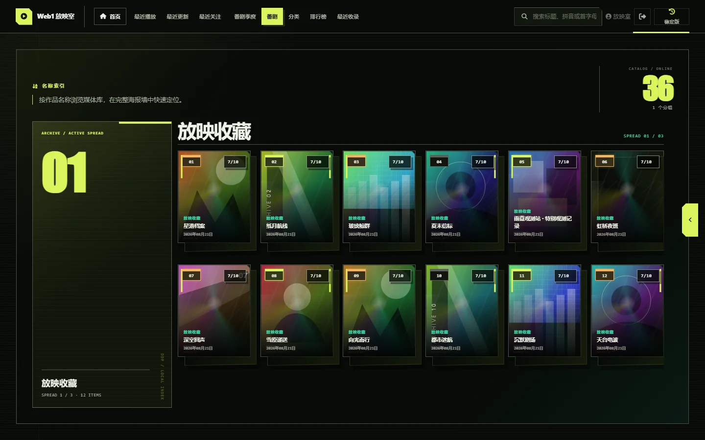
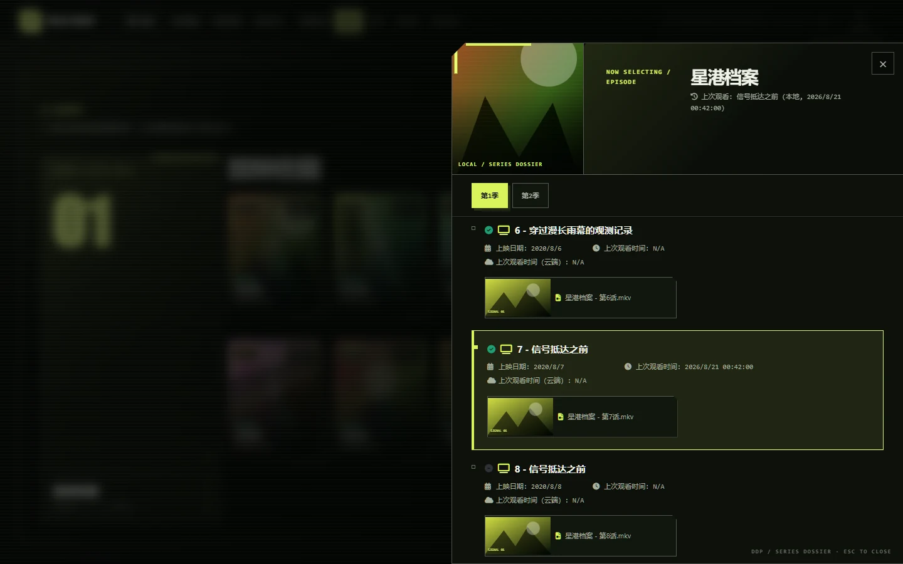
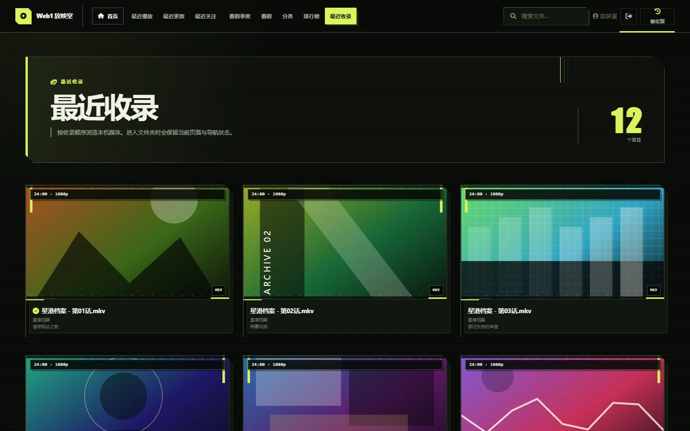
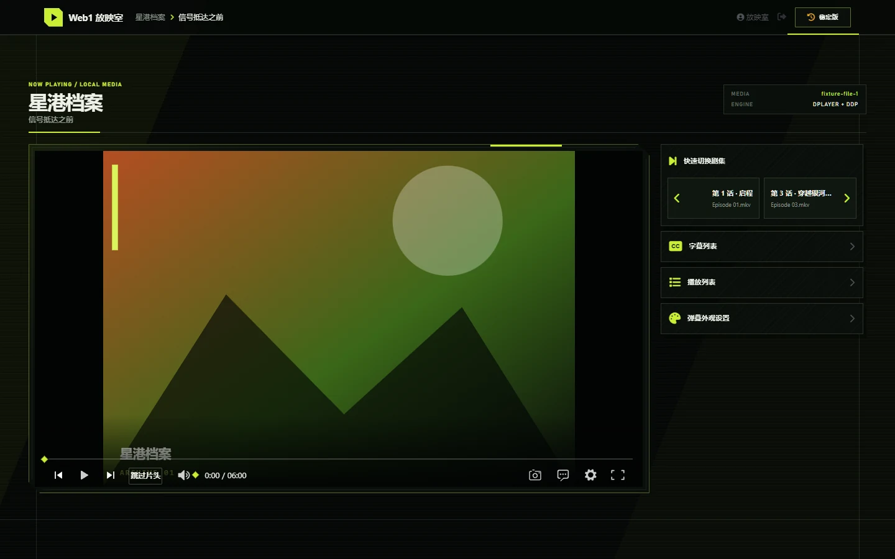
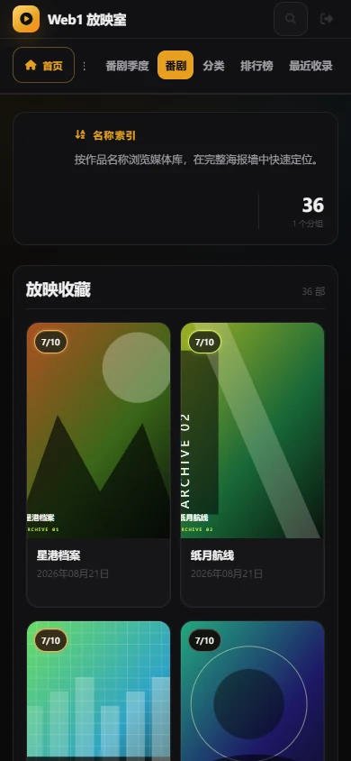

# DanDanPlay Personal Web Style

弹弹play Web1 的非官方视觉与交互改版，用连续 CD 架、媒体封套和放映控制台浏览自己的媒体库。

**当前版本：3.4 · 兼容弹弹play Windows 18.1.3**

**[下载 3.4 安装包 ZIP](https://github.com/OuNiSang/DanDanPlay-Personal-Web-Style/releases/download/3.4/DanDanPlay-Personal-Web-Style-3.4.zip)** · [版本说明与校验文件](https://github.com/OuNiSang/DanDanPlay-Personal-Web-Style/releases/tag/3.4)

3.4 在播放器内加入上一集、下一集图标，修复点击“跳过片头”后控制栏不收起的问题，并适配手机小尺寸。最近更新从今天开始排列，拥挤日期的卡片完整保留；打开番剧详情时，背景列表和翻页位置保持不动。

> 电脑端默认使用 3.x 界面，右上角可切换稳定版。宽度不超过 768px 时自动使用 2.4 稳定布局。桌面模式仍沿用 Web1 3.0 标识，以保留原有偏好设置。新的播放器控制同时适用于桌面、稳定版和手机。

## 界面预览

### 连续 CD 架与首次展开

最近播放作品排成一整架收藏。架子高速入场、减速停稳，再原位展开；中间卡面便于阅读，两侧书脊保持连续。首次展开只等待实际使用封面的加载与解码，其他分区、播放记录核对和外部搜图不挡住入场。后到数据保留当前选中作品。


### 开盒、装载与播放

选择作品后打开盒体，点击碟片装入播放器并进入播放页。Hero 的过场从碟片开始；详情文件行、上下集和播放列表则从实际点击的矩形区域展开。慢请求期间保持加载，媒体元数据就绪后揭幕，支持取消及错误退出。


### 最近更新与继续观看

最近更新左侧固定为**今天**，向右依次是昨天及前五天，按访问者设备的本地日历划分。未来日期单独标注；当天作品较多时可以在原有栏位内滚动查看全部卡片，手机保留完整近期列表，“更早”入口可进入完整归档。

原有角标以**琥珀色**表示网络已更新、本地尚未跟上，以**酸绿色**表示确认本地已覆盖更新；信息不足时保持中性。日期继续兼容跨午夜、显式时区偏移和夏令时。




### 媒体库与详情

番剧库保留分页封套、搜索、键盘操作及连续侧边详情。打开、加载和关闭详情时，背景卡片、归档分页和滚动位置保持不动；最近观看信息到达后更新现有卡片。季度栏和剧集列表共用抽屉宽度，定位最近观看集数时只滚动剧集列表。





文件列表保留本地、远程、最近收录、未识别及独立文件入口。



### 播放器

播放控制栏内可直接切换**上一集 / 下一集**，顺序与播放列表一致，首尾自动禁用。**跳过片头**仍向前跳过 85 秒，保持原先播放或暂停状态，并限制在片尾。

鼠标或触屏点击后释放按钮焦点，播放中的控制栏按原有计时自动收起；键盘操作保留清晰焦点，不误触全局播放快捷键。窄播放器使用图标与双行控制栏，为时间、弹幕和全屏按钮留出空间，三个控制区域均为 44×44px。



### 手机端

| 首页 | 番剧库 |
| --- | --- |
|  |  |


以上截图和 GIF 来自 3.4 候选运行文件，使用虚构作品、明暗封面、长短标题与缺图案例，不含真实媒体清单、账号、服务器或播放记录。GIF 是界面演示，不代表实际设备帧率。

## 安装与回退

1. 下载独立附件 **`DanDanPlay-Personal-Web-Style-3.4.zip`** 并完整解压，不要直接在压缩包内运行。
2. 建议先退出弹弹play。
3. 双击 `manage-style.bat`，选择 `1` 安装或重新应用。
4. 在弹弹play中开启远程访问，进入客户端显示地址的 `/web1/index.html`。
5. 需要回退时再次运行管理器并选择 `2`；选择 `3` 查看安装与版本状态。

安装包包含 28 个运行文件及管理器、许可证和安装说明；截图/GIF 留在项目主页。使用同一 Release 的 `.zip.sha256` 文件核对完整性。

管理器默认中文，主菜单选择 `4` 可切换英文。优先读取 Web1 目录同级的 `dandanplay.exe` 版本；版本不匹配或无法识别时会提示确认。3.4 的安装、状态、重复应用和回退使用 `18.1.3.0` 验证，无需跳过版本检查。

待覆盖文件有变化时先备份；重复应用同一版本不重复创建备份。回退恢复原有文件，并移除安装时新增的文件。备份位于：

```text
%LOCALAPPDATA%\DanDanPlay-Personal-Web-Style\backups
```

弹弹play更新覆盖网页后可重新安装。跨版本更新可能调整模板或 API，请检查兼容目标并保留备份。

GitHub 自动生成的 `Source code` 压缩包仍可用，推荐使用独立安装附件。附件下载次数表示请求次数，不等于独立用户或安装人数；本项目没有为此添加使用遥测。

## 更新记录

### 3.4

- 在播放器内加入上一集、下一集图标，沿用播放列表顺序及首尾禁用状态。
- 修复“跳过片头”的指针焦点残留，恢复桌面和触屏点击后的自动隐藏，保留键盘可见焦点。
- 为手机和窄播放器提供图标、44px 操作区域及双行布局，检查 320–390px 与长时长显示。
- 最近更新按本地日历从今天向前排列七天，未来内容单独展示，修复拥挤日期卡片丢失。
- 打开、加载和关闭番剧详情时保留背景位置；最近观看信息更新现有卡片，剧集定位不再滚动背景。
- 更新候选包截图与效果 GIF，提供独立安装 ZIP 和 SHA-256 校验文件。

### 3.3

修正本地文件覆盖进度、设备时区、首次展开图片就绪与慢播放加载；增加 85 秒片头跳过及独立 ZIP，修复缺图和导航遮挡。

### 3.2 / 3.1

统一播放入口的放映闸门，完善连续全宽 CD 架、循环切换、碟片深度和详情抽屉。

### 3.0 / 2.4

完成电脑端首页、媒体库、文件列表和播放器统一改版；手机与窄屏沿用 2.4 稳定布局。

## 验证范围

发布检查覆盖 2048、1440、1280、900、768 和 390px；播放器额外检查 360/320px、长时长、鼠标、键盘、触屏、全屏及二十次连续换集。功能记录覆盖正常、空内容、加载、失败、日期边界、重复打开/关闭详情、跳过片头和安装回退。

保留 NancyFx 模板、现有媒体库 API、DPlayer、字幕、弹幕、播放记录、文件路由和版本偏好，不引入新生产依赖。安装器在 PowerShell 7 和 Windows PowerShell 5.1 下验证。

无头浏览器不等于实体手机、Safari 原生视频全屏或实际显卡认证。原生修饰键的新标签创建已检查，新标签完整加载仍有测试环境限制。快速连续切换的 60Hz 帧预算与真实显卡表现尚未完成验收，**不承诺 60fps**。不同编码、字幕与转码服务仍取决于弹弹play和浏览器。

## 自定义目录与打包

```powershell
pwsh -NoProfile -File .\scripts\manage-style.ps1 -Action install -TargetPath "D:\path\to\web"
pwsh -NoProfile -File .\scripts\manage-style.ps1 -Action status -TargetPath "D:\path\to\web"
pwsh -NoProfile -File .\scripts\manage-style.ps1 -Action restore -TargetPath "D:\path\to\web"
```

管理器兼容 Windows PowerShell 5.1。命令行遇到版本不匹配时默认退出；仅在自行确认兼容性后才考虑 `-Force`。

维护者可用 PowerShell 7 执行 `scripts/build-release.ps1 -Version 3.4`，向 `dist/` 生成 ZIP 与校验文件。脚本核对 manifest 和 payload 完整文件集合，并拒绝覆盖已有产物。

`payload/` 按实际测试源码保留文件字节，Git 不自动改写其中的行尾；安装附件与对应版本的 payload 可逐文件校验。

## 声明

本项目是个人维护的非官方界面修改，与弹弹play官方无隶属或背书关系。应用中的作品图片来自用户媒体库及元数据服务；公开包不附带真实番剧图片、媒体、账号配置、服务器地址、播放记录或弹弹play自带的第三方前端资源。
